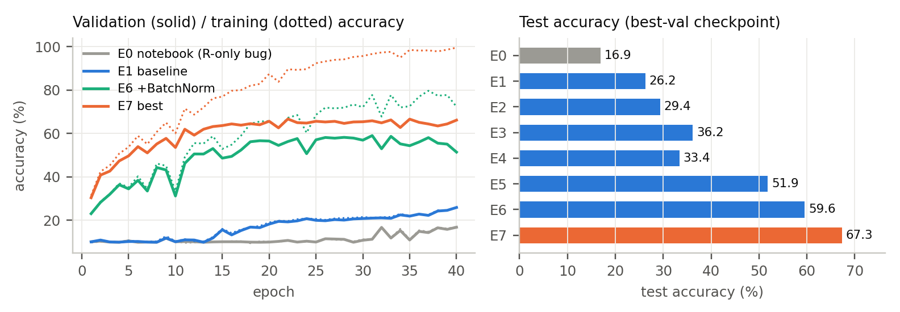
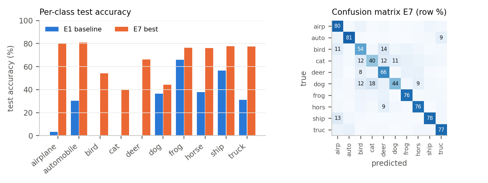
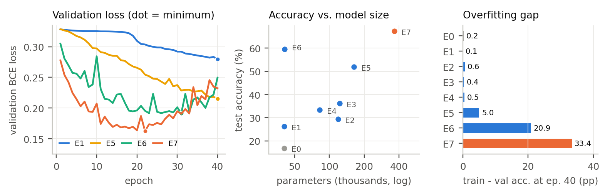

# CNN Image Classification on CIFAR-10: Effect of ConvNet Architecture

**Author:** Anugrah Putra Al Fatih (26/590120/PPA/07385)

This repository studies how changes to a small convolutional neural network (ConvNet) affect image-classification performance on **CIFAR-10**. It starts from the course notebook (`colab img_clf.ipynb`) and trains **8 architecture variants** under identical training conditions. It then compares their accuracy, macro-F1, per-class behaviour, overfitting, training time and inference latency.

The final report (3 pages, A4) is included: **[Report_ConvNet_Experiments_Anugrah_Putra_Al_Fatih.pdf](Report_ConvNet_Experiments_Anugrah_Putra_Al_Fatih.pdf)**

---

## Table of contents

- [Key results](#key-results)
- [Bug fix in the original notebook](#bug-fix-in-the-original-notebook)
- [Experimental setup](#experimental-setup)
- [Architectures](#architectures)
- [Figures](#figures)
- [Main findings](#main-findings)
- [Repository structure](#repository-structure)
- [Installation](#installation)
- [Usage](#usage)
- [Output format](#output-format)
- [Limitations](#limitations)
- [Possible improvements](#possible-improvements)
- [References](#references)

---

## Key results

All runs use the same data split, optimizer, loss, batch size, number of epochs (40) and random seed (0). Only the architecture changes.

| ID | Architecture change (vs. E1) | Params | Best epoch | Val acc (%) | **Test acc (%)** | Macro F1 | Train time (s) | Latency (ms/img) |
|----|------------------------------|-------:|:----------:|:-----------:|:----------------:|:--------:|:--------------:|:----------------:|
| E0 | Notebook as-is (loader copies R channel to G, B) | 40,810 | 40 | 16.8 | 16.9 | 0.115 | 119 | 0.28 |
| E1 | **Baseline**: 3 conv (16-32-64), k3, GAP, FC 128-64-10 | 40,810 | 40 | 25.9 | 26.2 | 0.201 | 131 | 0.27 |
| E2 | Wider: 32-64-128 filters | 118,666 | 40 | 28.8 | 29.4 | 0.247 | 178 | 0.37 |
| E3 | Deeper: 4 conv blocks (16-32-64-128), padding = 1 | 122,858 | 39 | 34.7 | 36.2 | 0.346 | 176 | 0.34 |
| E4 | Kernel 5×5 (padding = 2) | 82,538 | 39 | 32.2 | 33.4 | 0.314 | 169 | 0.57 |
| E5 | Flatten 64×4×4 instead of global average pooling | 163,690 | 40 | 51.6 | 51.9 | 0.509 | 142 | 0.29 |
| E6 | Baseline + BatchNorm | 41,034 | 31 | 59.0 | 59.6 | 0.595 | 173 | 0.40 |
| **E7** | **Wide + padding + BatchNorm + Flatten + Dropout 0.3** | 364,874 | 22 | 66.7 | **67.3** | **0.668** | 290 | 0.57 |

*Val/test accuracy are measured on the checkpoint with the best validation accuracy. Train time = total time for 40 epochs on CPU (8 threads). Latency = single-image forward pass on CPU (batch size 1).*

**In short:** under the same training budget, architecture changes raised test accuracy from **26.2% → 67.3%**. The most effective single change was **BatchNorm**, which gave +33.4 pp with only 224 extra parameters.

---

## Bug fix in the original notebook

The `myData.__getitem__` method in the original notebook builds the RGB image like this:

```python
img_red   = np.array(self.dataset_data[index][0:1024]).reshape((32,32,1))
img_green = np.array(self.dataset_data[index][0:1024]).reshape((32,32,1))   # should be 1024:2048
img_blue  = np.array(self.dataset_data[index][0:1024]).reshape((32,32,1))   # should be 2048:3072
```

All three channels are sliced from `[0:1024]`, so the network sees the **red channel copied three times** instead of a colour image. In this repository:

- **E0** reproduces the bug on purpose (`red_only=True`) so its impact can be measured.
- **E1–E7** use the corrected channels: R = `0:1024`, G = `1024:2048`, B = `2048:3072`.

With the same network, fixing this bug alone improves test accuracy from **16.9% (E0) to 26.2% (E1)**.

---

## Experimental setup

| Setting | Value | Same as notebook? |
|---|---|:---:|
| Dataset | CIFAR-10 (python version) | ✅ |
| Training set | `data_batch_1` (10,000 images) | ✅ |
| Validation set | `data_batch_2` (10,000 images) | ✅ |
| Test set | `test_batch` (10,000 images) | ✅ |
| Input preprocessing | pixel / 255 (inside `forward`) | ✅ |
| Output / loss | Sigmoid + binary cross-entropy on one-hot labels | ✅ |
| Optimizer | SGD, lr = 0.0025, momentum = 0.9 | ✅ |
| Batch size | 10 (training) | ✅ |
| Epochs | **40** (notebook: 1) | ❌ |
| Model selection | Best validation-accuracy checkpoint is tested | ❌ (new) |
| Seed | 0 (fixed for model init and data shuffling) | ❌ (new) |
| Hardware | CPU, PyTorch CPU build, 8 threads (notebook: Colab GPU) | ❌ |

**Why 40 epochs?** With this optimizer and loss, the from-scratch ConvNet stays at about 10% accuracy (chance level) for the first ~10 epochs. After only 1 epoch, all variants would look the same, so 40 epochs are used to compare them fairly.

**Why tensors instead of the notebook `Dataset`?** The data is loaded once into a `TensorDataset`, which is much faster on CPU. The images, labels and channel order are the same as in the (corrected) notebook loader.

---

## Architectures

`experiments.py` defines a generalised `ConvNet` class that reproduces the notebook model and can switch individual design factors on or off:

| Argument | Meaning | Notebook default |
|---|---|---|
| `channels` | Filters per conv block; the tuple length sets the number of blocks | `(16, 32, 64)` |
| `kernel` | Convolution kernel size | `3` |
| `padding` | Convolution padding | `0` |
| `bn` | Add `BatchNorm2d` after every convolution | `False` |
| `dropout` | Dropout probability after each hidden FC layer | `0.0` |
| `head` | `"gap"` = global average pooling, `"flatten"` = flatten the feature map | `"gap"` |
| `fc` | Hidden fully-connected layer sizes | `(128, 64)` |

Each block is `Conv → [BatchNorm] → ReLU → MaxPool(2)`. The classifier is `[Linear → ReLU → [Dropout]] × len(fc) → Linear(10) → Sigmoid`.

### Baseline (E1) vs. best model (E7)

| Block | E1 baseline | Output | Params | E7 best | Output | Params |
|---|---|---|---:|---|---|---:|
| Input | – | 3×32×32 | – | – | 3×32×32 | – |
| Conv 1 | Conv3×3 3→16, ReLU, MaxPool | 16×15×15 | 448 | Conv3×3 p1 3→32, BN, ReLU, MaxPool | 32×16×16 | 960 |
| Conv 2 | Conv3×3 16→32, ReLU, MaxPool | 32×6×6 | 4,640 | Conv3×3 p1 32→64, BN, ReLU, MaxPool | 64×8×8 | 18,624 |
| Conv 3 | Conv3×3 32→64, ReLU, MaxPool | 64×2×2 | 18,496 | Conv3×3 p1 64→128, BN, ReLU, MaxPool | 128×4×4 | 74,112 |
| Head | Global average pool | 64 | 0 | Flatten | 2048 | 0 |
| FC 1 | Linear 64→128, ReLU | 128 | 8,320 | Linear 2048→128, ReLU, Dropout | 128 | 262,272 |
| FC 2 | Linear 128→64, ReLU | 64 | 8,256 | Linear 128→64, ReLU, Dropout | 64 | 8,256 |
| FC 3 | Linear 64→10, Sigmoid | 10 | 650 | Linear 64→10, Sigmoid | 10 | 650 |
| **Total** | | | **40,810** | | | **364,874** |

### What each experiment tests

| ID | Design factor | Question |
|---|---|---|
| E0 | Input data | How much does the channel bug hurt? |
| E1 | – | Reference model (notebook ConvNet, correct RGB) |
| E2 | Width | Do more filters per layer help? |
| E3 | Depth | Does a 4th conv block help (padding keeps the map from shrinking to zero)? |
| E4 | Receptive field | Do larger 5×5 kernels help? |
| E5 | Aggregation head | Does keeping spatial layout (Flatten) beat global average pooling? |
| E6 | Normalisation | Does BatchNorm help optimisation? |
| E7 | Combination | What do all helpful factors plus Dropout achieve together? |

---

## Figures

**Figure 1:** Learning curves (left) and test accuracy of all variants (right).



**Figure 2:** Per-class test accuracy, baseline vs. best (left), and row-normalised confusion matrix of E7 (right).



**Figure 3:** Validation loss (left), accuracy vs. model size (middle) and overfitting gap (right).



### Per-class test recall (%)

| ID | plane | auto | bird | cat | deer | dog | frog | horse | ship | truck | Mean |
|----|:----:|:----:|:----:|:---:|:----:|:---:|:----:|:-----:|:----:|:-----:|:----:|
| E0 | 0 | 17 | 5 | 0 | 0 | **54** | 50 | 1 | 10 | 32 | 16.9 |
| E1 | 3 | 30 | 0 | 0 | 0 | 37 | 66 | 38 | 56 | 31 | 26.2 |
| E2 | 16 | 52 | 2 | 1 | 5 | 38 | 62 | 38 | 50 | 29 | 29.4 |
| E3 | 40 | 56 | 11 | 10 | 30 | 37 | 41 | 50 | 51 | 34 | 36.2 |
| E4 | 32 | 60 | 14 | 16 | 22 | 21 | 36 | 48 | 65 | 21 | 33.4 |
| E5 | 52 | 75 | 29 | 28 | 45 | 38 | 68 | 63 | 72 | 48 | 51.9 |
| E6 | 65 | 73 | 51 | **51** | 46 | 41 | 73 | 51 | **82** | 62 | 59.6 |
| E7 | **80** | **81** | **54** | 40 | **66** | 44 | **76** | **76** | 78 | **77** | 67.3 |

---

## Main findings

1. **Correct input data comes before architecture.** Fixing the RGB loader alone raised test accuracy from 16.9% to 26.2%. Colour cues such as blue sky/sea (airplane, ship) and green background (frog, deer) are lost with the bug.
2. **The baseline underfits.** E1 ends with 26.0% *training* accuracy, the same as its validation accuracy. The bottleneck is optimisation and capacity, not overfitting. Sigmoid + BCE with a small learning rate gives weak gradients at the start, and the tiny 2×2 final feature map is averaged into only 64 features.
3. **Width helps least.** Doubling the filters (E2, 2.9× params) gave only +3.1 pp. A 4th conv block (E3, +9.9 pp) and 5×5 kernels (E4, +7.1 pp) helped more. Larger receptive fields and keeping spatial resolution matter more than raw width.
4. **Flatten beats global average pooling for a shallow network.** E5 gained +25.6 pp because GAP throws away *where* a feature appears. The cost is 4× more parameters and the first sign of overfitting (5 pp train–val gap).
5. **BatchNorm is the most effective change.** E6 gained +33.4 pp with only 224 extra parameters and reached 25% validation accuracy at epoch 2 instead of epoch 40. It is also the best accuracy-per-parameter model.
6. **The best model (E7) reaches 67.3%, but it overfits.** Training accuracy reaches 99.6% while validation plateaus at ~65% from epoch ~20. Validation loss rises again after epoch 22 (0.162 → 0.232) while accuracy stays flat, so the model is becoming over-confident on wrong predictions.
7. **Parameter count is not what matters most.** E6 (41k params) beats E2, E3 and E5, which have 3–4× more parameters. *How* the parameters are used (normalisation, spatial head) matters more than how many there are.
8. **Animals are harder than vehicles.** For E7, vehicles score 77–81% recall, while cat (40%) and dog (44%) are the hardest. The main confusions are dog→cat (18%), bird→deer (14%), ship→airplane (13%) and automobile→truck (9%).

**Ranking of design factors by impact:** BatchNorm > keeping spatial information (Flatten/padding) > depth / receptive field > width.

---

## Repository structure

```
.
├── colab img_clf.ipynb        # Original course notebook (Colab version, with outputs)
├── img_clf.ipynb              # Original course notebook (local version)
├── experiments.py             # Trains and evaluates all ConvNet variants (E0–E7)
├── make_figures.py            # Builds Figures 1–3 from results/*.json
├── build_report.py            # Builds the 3-page A4 PDF report
├── Report_ConvNet_Experiments_Anugrah_Putra_Al_Fatih.pdf
├── requirements.txt
├── results/
│   ├── E0_notebook_bug.json   # One JSON file per experiment (metrics, logs, confusion matrix)
│   ├── ...
│   ├── E7_bn_wide_drop.json
│   └── fig/
│       ├── fig1.png
│       ├── fig2.png
│       └── fig3.png
└── cifar-10-batches-py/       # Dataset (not committed, see Installation)
```

---

## Installation

### 1. Clone the repository

```bash
git clone https://github.com/anugrahhhhh/CNN-Image-Classification-2.git
cd CNN-Image-Classification-2
```

### 2. Install dependencies

Python 3.10+ is recommended.

```bash
pip install -r requirements.txt
```

The experiments were run with Python 3.10.6, PyTorch 2.14.1 (CPU), NumPy 2.2.0, pandas 2.2.3, Matplotlib 3.10.9 and ReportLab 5.0.1. For a GPU build of PyTorch, follow the instructions at <https://pytorch.org/get-started/locally/>.

### 3. Download CIFAR-10

Download the **python version** of CIFAR-10 and extract it into the repository root:

```bash
# Linux / macOS / Git Bash
curl -O https://www.cs.toronto.edu/~kriz/cifar-10-python.tar.gz
tar -xzf cifar-10-python.tar.gz
```

After extracting, the folder `cifar-10-batches-py/` should contain `data_batch_1` … `data_batch_5`, `test_batch` and `batches.meta`.

---

## Usage

### Run all experiments

```bash
python experiments.py
```

This trains E0–E7 one after another and writes one JSON file per experiment to `results/`. Progress is printed for every epoch:

```
E1_baseline ep40 train_loss=0.2812 train_acc=0.260 val_loss=0.2797 val_acc=0.259 2.9s
== E1_baseline: params=40810 best_ep=40 val=0.2590 test=0.2625 train_time=131s latency=0.27ms
```

The full run takes about **25 minutes on a CPU** (8 threads).

### Run selected experiments only

Pass experiment names as arguments:

```bash
python experiments.py E1_baseline E6_batchnorm
```

Available names: `E0_notebook_bug`, `E1_baseline`, `E2_wider`, `E3_deeper`, `E4_kernel5`, `E5_flatten`, `E6_batchnorm`, `E7_bn_wide_drop`.

### Add a new experiment

Add an entry to the `EXPERIMENTS` dictionary in `experiments.py`, for example:

```python
"E8_deep_bn": dict(arch=dict(channels=(32, 64, 128, 256), padding=1, bn=True),
                   desc="Deeper + wider + BatchNorm"),
```

Then run `python experiments.py E8_deep_bn`.

### Change the training settings

Edit the constants at the top of `experiments.py`:

```python
EPOCHS = 40   # number of training epochs
SEED = 0      # random seed
torch.set_num_threads(8)
```

### Regenerate figures and report

```bash
python make_figures.py   # writes results/fig/fig1.png, fig2.png, fig3.png
python build_report.py   # writes the PDF report
```

---

## Output format

Each `results/<experiment>.json` contains:

| Key | Description |
|---|---|
| `name`, `desc` | Experiment ID and description |
| `params` | Number of trainable parameters |
| `best_epoch`, `best_val_acc` | Epoch and value of the best validation accuracy |
| `test_acc`, `test_loss` | Test accuracy and BCE loss of the best checkpoint |
| `train_time_s` | Total training time (seconds) |
| `latency_ms` | Average single-image inference time (ms) |
| `per_class` | Test recall for each of the 10 classes |
| `cm` | 10×10 confusion matrix (rows = true class, columns = predicted) |
| `log` | Per-epoch `train_loss`, `train_acc`, `val_loss`, `val_acc`, `time` |

CIFAR-10 class order: `airplane, automobile, bird, cat, deer, dog, frog, horse, ship, truck`.

---

## Limitations

- Each configuration was trained **once** (seed 0). Differences of 1–3 pp (e.g. E2 vs. E4) are within the range that run-to-run noise could produce.
- Only **one training batch** (10,000 images) is used, as in the notebook. This exaggerates overfitting for the larger models.
- Hyper-parameters (learning rate, batch size, epochs) were **not re-tuned** per architecture. This disadvantages slow learners such as E1, which is still improving at epoch 40.
- The EfficientNet-B0 transfer-learning part of the notebook was not re-run. For reference, its saved Colab output reports 27.9% test accuracy after 1 epoch, also with the RGB bug.

---

## Possible improvements

- Data augmentation (random crop, horizontal flip)
- Training on all 5 training batches (50,000 images)
- Weight decay and a learning-rate schedule (e.g. cosine or step decay)
- **Softmax + cross-entropy** instead of sigmoid + BCE, since this is a single-label task
- Early stopping on validation loss, to get a better-calibrated model
- Repeating each experiment with several seeds and reporting mean ± std

---

## References

- A. Krizhevsky, *Learning Multiple Layers of Features from Tiny Images*, 2009. CIFAR-10: <https://www.cs.toronto.edu/~kriz/cifar.html>
- S. Ioffe and C. Szegedy, *Batch Normalization: Accelerating Deep Network Training by Reducing Internal Covariate Shift*, ICML 2015.
- N. Srivastava et al., *Dropout: A Simple Way to Prevent Neural Networks from Overfitting*, JMLR 2014.
- M. Lin, Q. Chen and S. Yan, *Network In Network* (global average pooling), ICLR 2014.
- M. Tan and Q. Le, *EfficientNet: Rethinking Model Scaling for Convolutional Neural Networks*, ICML 2019.
- PyTorch documentation: <https://pytorch.org/docs/stable/>

---

**Author:** Anugrah Putra Al Fatih · Student number 26/590120/PPA/07385
